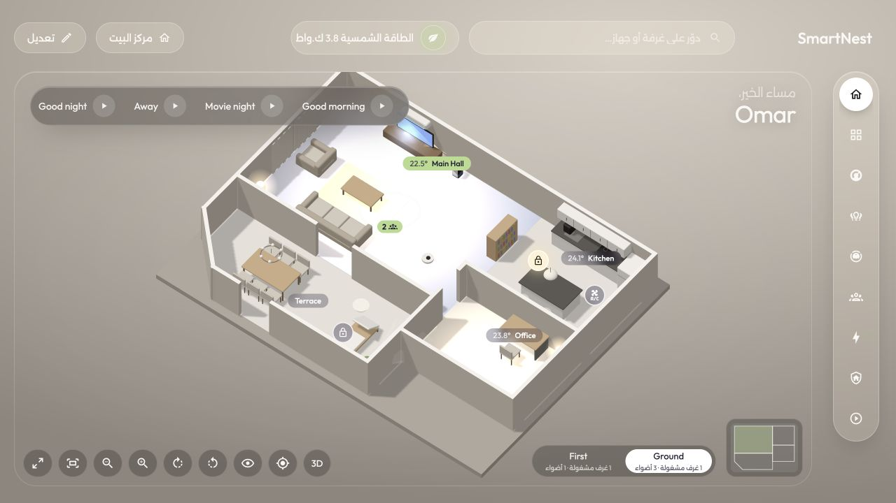
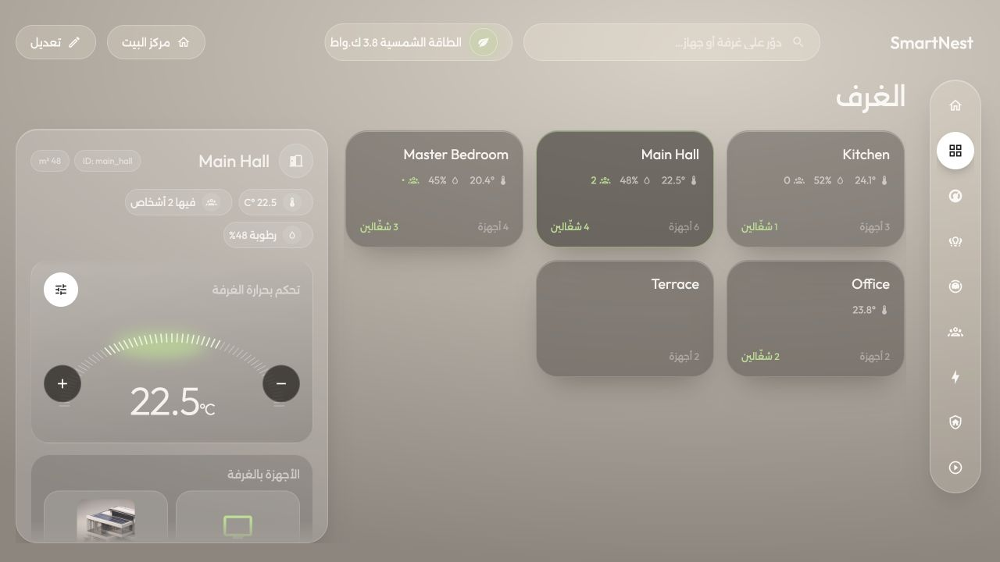
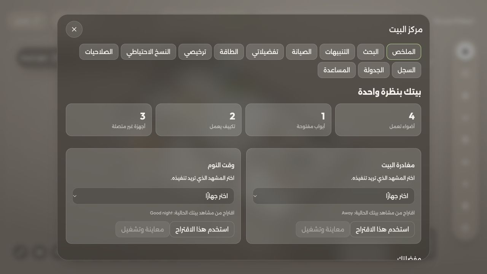

# SmartNest Pro — داشبورد بيتك على Home Assistant

[English README](../README.md) · [الموقع](https://smartnest.pro) · [صور الداشبورد على الموقع](https://smartnest.pro/#dashboard-preview)

واجهة بتجمع مخطط البيت ثلاثي الأبعاد والغرف والأجهزة والمشاهد في مكان واحد، مع دعم العربية والإنجليزية. بتشتغل من الهاتف والتابلت والكمبيوتر، والأجهزة الظاهرة بتعتمد على الكيانات المضافة عندك في Home Assistant.

## جديد الإصدار0.17

[دليل التحسينات الخمسين وطريقة الوصول لكل ميزة](experience-0.17.md). يتضمن استجابة الأجهزة، زوايا المخطط والطبقات، التعرفة الساعية، الصيانة حسب الاستخدام ووضع الأطفال. أعد تشغيل Home Assistant بعد تنزيل التحديث.

## صور فعلية من الواجهة

الصور التالية ملتقطة من نسخة المعاينة المحلية للمشروع؛ أسماء الغرف والأجهزة والقراءات بيانات تجريبية. المخطط مثال، وبتجهّز مخطط بيتك من أدوات التعديل.

### مخطط البيت التفاعلي

ارسم الغرف، أضف الأثاث واربط الأجهزة بمكانها. بتقدر تتحرك داخل المخطط، تختار غرفة وتوصل لأجهزتها ومشاهدها.

### الغرف والأجهزة

كل غرفة بتجمع الأجهزة المرتبطة فيها، وبتعرض الحرارة والرطوبة والإشغال عند توفر الحساسات المناسبة في Home Assistant.

### مركز البيت

ملخص لحالة البيت، مع البحث والتنبيهات والصيانة وتفضيلات الشاشة والترخيص والنسخ الاحتياطي وأدوات المساعدة. بعض الأدوات تحتاج صلاحيات مسؤول.

## قبل التثبيت

- Home Assistant شغّال عندك، وHACS مثبت.
- أجهزتك وكياناتك مضافة في Home Assistant؛ الداشبورد لا يستبدل تكاملات الأجهزة.
- مفتاح ترخيص صالح واتصال بالإنترنت للتفعيل والتحقق الدوري.
- يُفضّل إعداد المخطط من كمبيوتر أو تابلت بحساب مسؤول.

## التثبيت عن طريق HACS

1. افتح **HACS → ⋮ → Custom repositories**.
2. أضف الرابط `https://github.com/Yenjo93/smartnest-pro` واختَر **Integration**.
3. نزّل **SmartNest**، ثم أعد تشغيل Home Assistant بوقت مناسب لبيتك.
4. افتح **Settings → Devices & services → Add integration → SmartNest**.
5. أدخل مفتاح الترخيص. بعدها بتظهر **SmartNest** بالقائمة الجانبية.
6. افتحها واتبع إعداد أول تشغيل. إذا عندك إعداد سابق، المساعدة موجودة ضمن **مركز البيت**.

ملفات الواجهة الجاهزة موجودة بالمستودع؛ المستخدم لا يحتاج تشغيل أدوات بناء أو تثبيت حزم JavaScript.

## تجهيز بيتك

1. رتّب أجهزة Home Assistant ضمن **Areas** لربطها بالغرف.
2. افتح **تعديل → تعديل المخطط** وارسم الغرف والجدران والأبواب.
3. أضف قطع الأثاث واربط القطع الذكية بأجهزتها عند الحاجة.
4. اختر حساسات الحرارة والرطوبة والإشغال والطاقة من إعدادات الغرف والبطاقات.
5. احفظ التعديلات؛ الشاشات المتصلة بنفس تثبيت Home Assistant بتستخدم نفس إعداد البيت.

تفضيلات الشاشة مثل اللغة والمظهر ووضع الشاشة الجدارية قابلة للتخصيص. خصائص مثل الكاميرات والطاقة والروبوت تحتاج الأجهزة والتكاملات والحساسات المناسبة.

## التجربة والترخيص

اطلب **شهر تجربة مجاني** من [الموقع](https://smartnest.pro/license). التجربة تصدر بعد مراجعة الطلب ولا تتحول تلقائيًا لاشتراك مدفوع. سعر ترخيص السنة المعروض **35 دولار أمريكي**؛ راجع [طريقة الدفع وحالة توفره](https://smartnest.pro/patreon) قبل الدفع.

كل مفتاح مرتبط بتثبيت Home Assistant واحد؛ عدة هواتف وتابلت على نفس التثبيت تشترك بنفس الترخيص. لا تنشر المفتاح في الصور أو الفيديو أو GitHub Issues. يمكن للمالك إصدار تراخيص مدى الحياة للاستخدام الخاص من لوحة الإدارة، وهي غير معروضة للبيع.

## الدعم والتجديد

ابعت طلبك من [smartnest.pro/support](https://smartnest.pro/support) واذكر رقم الطلب أو رقم الترخيص إذا موجود. لا ترسل كلمات المرور أو رموز الوصول أو مفتاح التفعيل الكامل ضمن طلب الدعم.

SmartNest مشروع مستقل، وليس منتجًا رسميًا من Home Assistant.
